<div align="center">



# CNC 模拟器 Pro

### 免费的浏览器端 CNC 铣削模拟器，支持实时 G-code 动画

在浏览器中运行一台真实的 CNC 机床 — 随着 G-code 执行，在 3D 中观看材料被切削去除。无需安装、无需注册、无需付费。**100% 客户端运行。**

**[在线演示](https://rudra496.github.io/cnc/)** · **[报告问题](https://github.com/rudra496/cnc/issues)**

</div>

---

基于 **Vue 3**、**Vite**、**Element Plus**、**TresJS**、**Three.js**、**Pinia** 和 **TypeScript** 构建，以静态站点形式部署到 **GitHub Pages**。

---

## 功能特性

### 3D 机床与仿真
- 高保真龙门立加 / SF-260 五轴摇篮等机型
- 真实材料去除（高度图工件）
- 按刀具几何渲染与实时刀路
- 相机预设：等轴测 / 俯视 / 前视 / 右视 / 重置

### 控制栏
- 液晶风格 DRO（X/Y/Z，五轴时 A/C）
- 传输控制：复位、单步、播放/暂停、单段运行
- 机床模式：运行 / 干运行 / 机床锁定
- 选择停止（M01）、跳过程序段（/）
- 循环速度 0.25×–10×、时间轴 scrubber
- 快捷键：`Space` / `←` / `→` / `R`

### 程序与学习
- G-code 编辑器（语法高亮、当前行、点击跳转）
- 34 个示例程序、15 个代码片段
- 程序库：保存 / 加载 / 导出 / 导入（localStorage）
- 28 把刀具、16 种材料、进给与转速计算器
- 64 条 G/M 代码参考 + 使用指南

---

## 本地开发

环境要求：Node 18+，Yarn 1.x。

```bash
yarn install
yarn dev      # http://localhost:3000
yarn build    # 输出到 dist/
yarn preview
```

GitHub Pages 项目页构建示例：

```bash
# 自动根据 GITHUB_REPOSITORY 设置 base
# 或手动：
VITE_BASE_PATH="/REPO" yarn build
```

---

## 键盘快捷键

| 按键 | 操作 |
|------|------|
| `Space` | 播放 / 暂停 |
| `→` | 前进一个程序段 |
| `←` | 后退一个程序段 |
| `R` | 复位到起点 |

---

## 项目结构

```
src/
├── main.ts                 # Vue + Pinia + Element Plus
├── App.vue                 # 顶栏 / 页脚
├── stores/
│   ├── sim.ts              # 仿真状态
│   └── view.ts             # 视图 / 相机
├── components/cnc/
│   ├── CncLayout.vue       # 分栏 + 标签页
│   ├── ControlBar.vue      # DRO 控制台
│   ├── CncScene.vue        # TresJS 3D 视口
│   ├── GCodeEditor.vue
│   ├── ProgramPanel.vue
│   ├── ProgramManager.vue
│   ├── ToolManager.vue
│   ├── MaterialPanel.vue
│   ├── FeedsCalculator.vue
│   ├── CodeReference.vue
│   ├── GuidePanel.vue
│   ├── SceneOverlay.vue
│   └── machines/           # SF-260 等机型
└── lib/cnc/                # 解析器、切削、刀具/材料库等
```

---

## 技术栈

- **Vue 3** · **Vite 6** · **TypeScript 5**
- **Element Plus** — UI
- **Tailwind CSS 4** — 布局与面板样式
- **TresJS** + **Three.js** — 3D
- **Pinia** — 状态
- **Yarn** — 包管理

---

## 部署到 GitHub Pages

推送到 `main` / `master` 后，[`.github/workflows/deploy.yml`](.github/workflows/deploy.yml) 会用 Yarn 构建并将 `dist/` 部署到 GitHub Pages。

仓库 Settings → Pages → Source: **GitHub Actions**。

---

## 许可证

MIT License — 见 [LICENSE](./LICENSE)。
